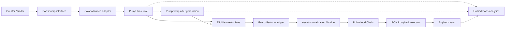
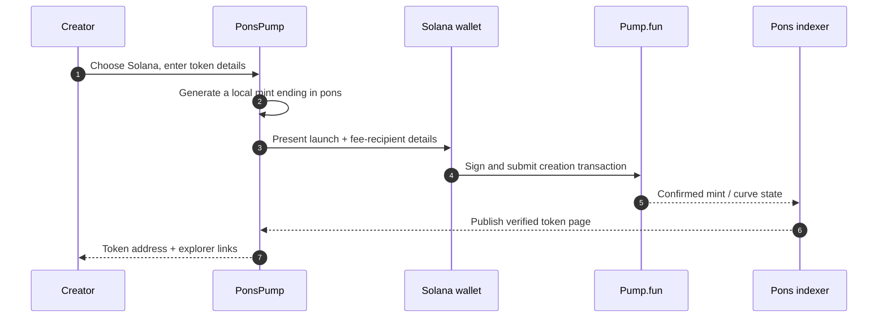
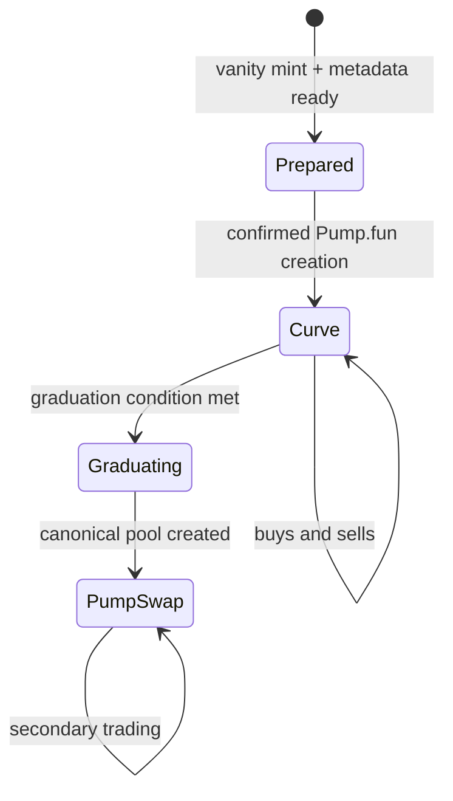
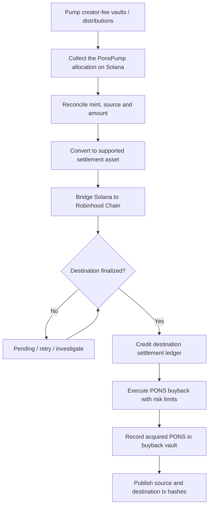
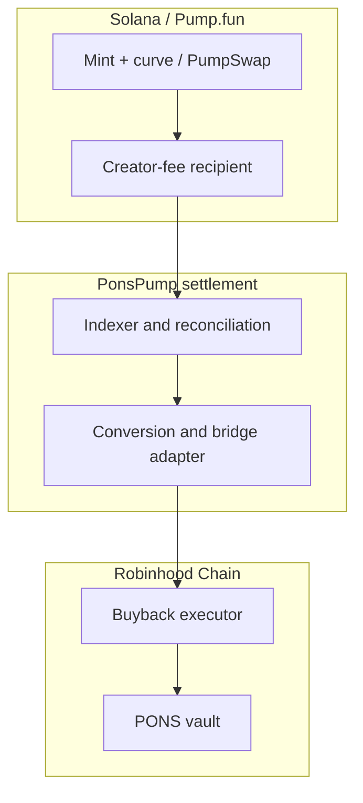

<div align="center">


# PonsPump Beta

**The first hybrid Pons launch experience on Solana.**

*Powered by a Pump.fun integration. Connected to Robinhood Chain. Designed around the PONS token.*

**Launch on Solana. Settle on Robinhood Chain. Buy back PONS.**

| Test reference | Solana mint address |
|---|---|
| **V1** | `` |

</div>

PonsPump Beta extends Pons beyond its native Robinhood Chain environment through a Solana launch experience built in collaboration with **Pump.fun**. Tokens are created and traded using the Pump.fun launch infrastructure, while Pons supplies the launch interface, cross-chain accounting, fee settlement, and a dedicated mechanism for acquiring **PONS on Robinhood Chain**.

The result is a hybrid architecture rather than a wrapped-token launchpad: the newly launched token **lives and trades on Solana**, but the PonsPump-designated portion of its eligible fees is periodically converted, transferred to Robinhood Chain, and used to execute transparent market buybacks of the native PONS token.

> **Beta scope.** This document describes the PonsPump Beta product and its intended technical design. Solana launches and cross-chain fee settlement are beta features; architecture, limits, integrations, contract addresses, and activation stages are subject to validation before production release. A token appearing in the interface does not prove that every settlement stage is live.

**Web:** [beta.ponsfamily.com](https://beta.ponsfamily.com) &nbsp;·&nbsp; **Launch chain:** Solana &nbsp;·&nbsp; **Settlement chain:** Robinhood Chain (`4663`) &nbsp;·&nbsp; **Launch infrastructure:** Pump.fun / PumpSwap &nbsp;·&nbsp; **Status:** Beta

---

## Contents

- [At a glance](#at-a-glance)
- [The hybrid model](#the-hybrid-model)
- [Access and rollout](#access-and-rollout)
- [Create a token](#create-a-token)
- [The `pons` vanity standard](#the-pons-vanity-standard)
- [Launch mechanics on Solana](#launch-mechanics-on-solana)
- [Fees: from Solana activity to PONS](#fees-from-solana-activity-to-pons)
- [Cross-chain settlement pipeline](#cross-chain-settlement-pipeline)
- [PONS buyback execution](#pons-buyback-execution)
- [Transparency and analytics](#transparency-and-analytics)
- [Protocol components](#protocol-components)
- [Compatibility with Pons v2](#compatibility-with-pons-v2)
- [Security, trust and failure handling](#security-trust-and-failure-handling)
- [Beta milestones](#beta-milestones)
- [Contracts and identifiers](#contracts-and-identifiers)
- [FAQ](#faq)
- [References](#references)
- [Metadata](#metadata)

---

## At a glance

| | |
|---|---|
| **Product** | PonsPump, the first Solana-native, Robinhood Chain-connected version of Pons |
| **Core experience** | Create, discover, and track Solana tokens through the Pons interface |
| **Collaboration / execution layer** | Pump.fun for launches and bonding-curve trading; PumpSwap for graduated tokens |
| **Settlement network** | Robinhood Chain, EVM chain ID `4663` |
| **Address identity** | Every PonsPump-branded launch targets a Solana mint ending in `pons` |
| **Economic connection** | Eligible, PonsPump-assigned creator-fee revenue is routed toward PONS buybacks |
| **Native PONS** | The existing token on Robinhood Chain; PonsPump does not issue a replacement PONS |
| **Cross-chain token model** | **No** automatic wrapping or bridging of newly created Solana tokens |
| **Custody of user trades** | Wallet-signed, noncustodial trading; settlement has separate, disclosed operational trust assumptions |
| **Status** | Limited beta; launch, fee-collection, bridging, and buyback availability are independently tracked |
| **Operator** | Pons Labs, LLC |
| **Contact** | contact@ponsfamily.com |
| **Updates** | [X @ponsdotfamily](https://x.com/ponsdotfamily) · [Pons docs](https://docs.ponsfamily.com) |

---

## The hybrid model

PonsPump connects two distinct functions without forcing either chain to imitate the other. **Solana handles launch execution and token trading. Robinhood Chain handles the PONS-denominated economic settlement.** A single Pons interface indexes the activity on both networks and maps it back to the same launch.



There are **three separate asset domains**:

| Domain | Where it exists | Purpose |
|---|---|---|
| **Launched token** | Solana SPL token | The asset users create and trade |
| **Fee / settlement asset** | Solana, then an approved bridged asset on Robinhood Chain | Carries PonsPump's eligible revenue across chains |
| **PONS** | Robinhood Chain | Target asset acquired by the buyback mechanism |

This separation is deliberate. Trading liquidity for a Solana token remains in its Pump.fun/PumpSwap market. Moving *fees* to Robinhood Chain does not move that token's supply, collateral, or liquidity pool.

### Why a single interface?

PonsPump reuses the Pons product surface without pretending the chains are interchangeable. Launch discovery, creator profiles, fee analytics, and activity history can be unified; signing, gas, confirmation rules, and trading contracts remain network-specific. A Solana wallet authorizes Solana transactions, and an EVM wallet is needed only for Robinhood Chain actions that require its own signature.

---

## Access and rollout

PonsPump begins as a controlled beta inside the broader Pons experience. Access to the app, eligibility to create a token, and enablement of the fee-settlement pipeline are **separate permissions**.

| Layer | Beta behavior |
|---|---|
| **App access** | Uses Pons's existing invite-based access model |
| **Launch creation** | Initially restricted to approved beta wallets |
| **Trading** | Uses the underlying Pump.fun/PumpSwap contracts and wallet approval flow |
| **Fee routing** | Enabled only for launches with a validated recipient configuration |
| **Cross-chain settlement** | Activated per supported route after reconciliation and bridge testing |
| **Public rollout** | Progressive, once execution, monitoring, and security checks pass |

No invite or whitelist status guarantees token quality, return, liquidity, or preferential execution.

---

## Create a token

**Proposed route:** `/launchpad/create` · **Network:** Solana

The Pons creation flow becomes chain-aware. Selecting **Solana / PonsPump** uses Pump.fun-compatible instructions rather than deploying a Pons v2 EVM token.

| Field | Behavior |
|---|---|
| **Network** | Solana (PonsPump Beta) or Robinhood Chain (Pons v2) |
| **Name and symbol** | New token metadata submitted during launch |
| **Description and image** | Project metadata stored using the supported metadata path |
| **Social links** | Website, X, Telegram, and other supported references |
| **Quote asset** | SOL or another quote supported by the current Pump.fun integration |
| **Vanity mint** | Local mint-key generation until the public key ends in `pons` |
| **Creator / fee configuration** | Displays the actual eligible creator-fee recipients and PonsPump share |
| **Initial purchase** | Optional, only where supported by the current launch instructions |
| **Wallet approval** | Solana transactions signed by the connected wallet |

### Launch sequence



A successful launch requires on-chain confirmation and a matching mint address. A submitted transaction or locally generated vanity key alone is not a completed launch. If a transaction fails, the client must not silently substitute a different mint.

---

## The `pons` vanity standard

Every PonsPump-branded token is intended to have a recognisable mint address whose **final four Base58 characters are exactly `pons`**.

**Canonical rule:** `mint.toBase58().endsWith("pons")`

Examples already used in the Pons Solana testing documentation:

| Test reference | Solana mint address |
|---|---|
| **V1** | `` |

> **Naming convention.** Pons may display a launch as `--pons` in marketing or user-interface copy. The two hyphens are a visual separator only. They are **not part of the mint address**: Solana public keys use Base58, which does not include `-`.

### How vanity mint generation works

The suffix is achieved by generating candidate Ed25519 keypairs and examining their Base58-encoded public keys, not by modifying a deployed token address. In the preferred noncustodial model, candidate private keys are generated **locally**, the valid mint keypair signs the mint creation transaction, and the secret is never transmitted to the Pons server.

A four-character Base58 suffix has a nominal search space of `58^4 = 11,316,496` candidates. Actual generation time varies with device performance, key-generation implementation, and resource limits. A background worker can keep the interface responsive while the user reviews the launch configuration.

```text
Candidate Ed25519 keypair
       |
       v
Base58(publicKey) endsWith("pons")?
       | no                  | yes
       +---- retry           v
                       Sign mint creation
                              |
                              v
                       Confirm on Solana
```

**Verification rules:**

- Validate the exact suffix, expected program ownership, mint account, and confirmed creation transaction.
- Never use the address suffix as proof that Pons created a token; unrelated parties can independently mine the same suffix.
- Bind PonsPump verification to the actual launch transaction, recorded fee configuration, and registry entry.
- Do not upload generated private keys to a backend or log them in browser telemetry.
- Do not claim a launch is protected against impersonation solely because its address ends in `pons`.

---

## Launch mechanics on Solana

PonsPump does **not** transplant the Pons v2 curve or Uniswap v4 lifecycle onto Solana. It uses the launch mechanics of the integrated Pump.fun programs and the fee parameters applicable to each launch.



| Stage | Execution and implications |
|---|---|
| **Mint creation** | A new SPL mint is initialized as part of the supported Pump.fun flow |
| **Price discovery** | Trading begins on Pump.fun's on-chain bonding curve |
| **Pre-graduation fees** | Creator fees, protocol fees, and other applicable charges follow Pump.fun's rules |
| **Graduation** | Liquidity migrates to the token's canonical PumpSwap market according to Pump.fun logic |
| **Post-graduation fees** | PumpSwap charges its applicable market-dependent schedule; eligible creator revenue can continue accruing |
| **Pons indexing** | The token remains visible in Pons with chain-specific market and fee data |

Pump.fun's live fee schedule can vary by quote asset, market capitalization, and protocol updates. **PonsPump does not publish a separate universal Pump.fun trading-fee rate.** The current network rules govern actual charges. See [Pump.fun fees](https://pump.fun/docs/fees) and [bonding-curve documentation](https://pump.fun/docs/bonding-curve).

---

## Fees: from Solana activity to PONS

The central economic feature of PonsPump is the **PONS Buyback Flow**: eligible launch-related revenue controlled by PonsPump is collected on Solana, normalized into a transferable settlement asset, moved to Robinhood Chain, and spent acquiring PONS from available market liquidity.

**This does not mean that all fees charged by Pump.fun belong to PonsPump.** Pump.fun's protocol fees and LP fees remain governed by Pump.fun. Only the creator-fee share actually assigned to PonsPump, or other explicitly disclosed PonsPump-controlled revenue, can enter the buyback flow.

### Fee ownership and routing

| Fee type | Origin | Treatment |
|---|---|---|
| **Pump.fun protocol fee** | Pump.fun / PumpSwap trades | Not claimed or redirected by PonsPump |
| **PumpSwap LP fee** | Graduated market | Remains subject to underlying pool and protocol rules |
| **Creator fee** | Eligible trading activity | Allocated according to the launch's on-chain recipient / sharing configuration |
| **PonsPump-designated allocation** | The portion of the creator-fee stream assigned to PonsPump | Collected for conversion and PONS buyback |
| **Creator-retained allocation** | Any remaining creator share | Remains with its disclosed recipient, if configured |

Where the Pump Fees sharing program is used, a launch can direct creator-fee entitlements to multiple recipients. For single-recipient legacy-style launches, the collector must use the correct separate claim procedures for bonding-curve and PumpSwap vaults. Fee collection must always follow the actual program version and vault configuration.

**Beta allocation principle:** **100% of the net PonsPump-designated fee allocation** is budgeted for PONS buyback. This is *not* a statement that 100% of all trading fees, or necessarily 100% of all creator fees, belong to PonsPump. Any creator/PonsPump split must be shown before the launch transaction is signed and confirmed on-chain.

### Accounting model

For a settlement period `t`:

```text
EligiblePonsPumpFees(t)
  = sum(creator_fees_collected_for_pons_pump_share)

BuybackBudget(t)
  = EligiblePonsPumpFees(t)
  - recorded Solana execution costs
  - recorded conversion costs
  - bridge costs
  - Robinhood Chain execution costs

PONSReceived(t)
  = sum(actual PONS tokens acquired in settled buyback trades)
```

Each deduction must be visible and attributable to a batch. If operational costs would make an execution uneconomic, the balance carries forward rather than being treated as purchased PONS. Negative budgets cannot create fictional buybacks.

### Illustrative flow

If a token accrues `1.00 SOL` in creator-fee revenue and its launch configuration grants `20%` of that revenue to PonsPump, the **gross PonsPump allocation is `0.20 SOL`**. The remaining `0.80 SOL` follows the creator-fee distribution rule. After actual settlement expenses, only the net proceeds from the `0.20 SOL` allocation can fund PONS purchases.

*The amounts and 20% share above are an accounting illustration, not a published beta-wide fee rate, quote, or promise of returns.*

---

## Cross-chain settlement pipeline

Solana and Robinhood Chain cannot perform one atomic, synchronous transaction across both chains. PonsPump therefore treats fee conversion and buybacks as **asynchronous, independently verifiable stages** connected by a settlement ledger.



### Stage specification

| Stage | Chain | Required evidence |
|---|---|---|
| **1. Accrual** | Solana | Mint, trade-derived fee source, creator-fee vault or distribution account |
| **2. Collection** | Solana | Confirmed claim/distribution transaction and actual received amount |
| **3. Normalization** | Solana | Swap route, asset in/out, execution fee, minimum output, transaction signature |
| **4. Transfer** | Cross-chain | Supported bridge route, message identifier, source finality, destination credit |
| **5. Allocation** | Robinhood Chain | Exact credited amount, destination token and ledger entry |
| **6. Buyback** | Robinhood Chain | PONS swap transaction, amount spent, PONS actually received |
| **7. Accounting** | Both | End-to-end settlement record joining all stages |

For the beta, a stable settlement denomination such as **USDC is the preferred normalization target**, subject to the availability of a supported Solana-to-Robinhood route and exact destination asset verification. There is **no assumption** that similarly named tokens on two networks are fungible or that every bridge route exists.

### Settlement batches

Small fee events may be accumulated into periodic batches rather than bridged individually. This reduces operational cost, improves execution efficiency, and allows reconciliation before any market buy.

A logical batch has the following state progression:

`ACCRUING → CLAIMED → NORMALIZED → BRIDGING → CREDITED → BUYBACK_EXECUTED → RECONCILED`

Failure states include `PAUSED`, `RETRYABLE`, and `MANUAL_REVIEW`. A batch is never marked `RECONCILED` until the destination amount, the buyback trade, and the final token receipt match the underlying chain data.

### Replay protection and reconciliation

An off-chain coordinator may schedule transactions, but the ledger must derive state from confirmed on-chain facts. Every collection, bridge transfer, and buyback has a unique identifier. The coordinator must not apply the same deposit twice, spend uncredited balances, or execute a second buyback merely because a network response timed out.

```text
settlement_id = hash(
    source_chain,
    source_tx,
    source_instruction_or_event_index,
    destination_chain,
    fee_recipient,
    allocation_version
)
```

This identifier is a **proposed indexer/accounting key**, not a claim that a deployed cross-chain contract already implements this exact hash format.

---

## PONS buyback execution

The end asset of a completed PonsPump settlement is the existing **PONS token on Robinhood Chain**. Buybacks take place against verifiable market liquidity rather than minting new tokens or assigning an artificial accounting price.

**PONS (Robinhood Chain):** `0x39dBED3a2bd333467115dE45665cC57F813C4571`

**Token page:** [PONS on Pons](https://beta.ponsfamily.com/launchpad/0x39dBED3a2bd333467115dE45665cC57F813C4571)

### Execution policy

| Control | Intended beta behavior |
|---|---|
| **Funding** | Only finalized, reconciled, PonsPump-assigned settlement balances |
| **Execution route** | Approved Robinhood Chain DEX route with a verified PONS output token |
| **Minimum received** | Every swap enforces a minimum PONS output |
| **Price impact** | Maximum impact per execution; large orders can be split into smaller fills |
| **Reference prices** | Sanity checks against sufficiently liquid, current market observations |
| **Batch size** | Configurable minimum and maximum spend thresholds |
| **Emergency control** | Pause new swaps when pricing, routing, or bridging is unsafe |
| **Recipient** | Disclosed PONS buyback vault / treasury contract |
| **Publication** | Report source fees, costs, swap inputs, PONS output, and destination holdings |

Bought PONS is **not automatically burned**. PonsPump's proposed default is to hold acquired PONS in an identifiable buyback vault and report its balance and transfers. Any later locking, vesting, redistribution, or burning policy would require a separately published rule and on-chain implementation.

The existing Pons v2 buyback mechanism has its own terms. **PonsPump buybacks are a distinct allocation path** and should not be described as inheriting v2's five-year vesting behavior unless that integration is expressly implemented and verified.

### What a buyback does — and does not do

A completed buyback proves that the protocol spent a documented amount of settlement assets to purchase a documented amount of PONS. It does **not** guarantee a minimum market price, sustained demand, a specific token return, or permanent removal of PONS supply. Pending bridge funds and unexecuted fee balances must not be counted as completed buys.

---

## Transparency and analytics

**Proposed surfaces:** `/launchpad` · `/launchpad/<mint>` · `/analytics` · `/profile`

PonsPump extends the existing multi-chain board while preserving chain provenance. A mint address is the canonical token identifier on Solana; an EVM contract address is the canonical identifier on Robinhood Chain. The interface must not treat identical symbols as identical assets.

| Module | What the user sees |
|---|---|
| **Launch board** | Chain, token, creator, launch status, liquidity venue, recency, and activity |
| **Token page** | Verified Solana mint, `pons` suffix, curve or PumpSwap status, links to transactions |
| **Fee attribution** | Total eligible creator fees, PonsPump allocation, creator-retained allocation |
| **Settlement tracker** | Claimed, converted, bridged, credited, spent, and outstanding amounts |
| **Buyback feed** | Robinhood Chain transaction hashes and PONS purchased per batch |
| **Protocol analytics** | Cumulative launched tokens, eligible fee revenue, execution costs, PONS acquired |
| **Creator profile** | Wallet-associated launches and their fee-routing configurations |

### Example launch record

```json
{
  "launch_id": "solana:<mint-address>",
  "network": "solana",
  "venue": "pump.fun",
  "mint_suffix": "pons",
  "status": "bonding_curve",
  "creator_wallet": "<solana-public-key>",
  "fee_policy": {
    "mode": "creator_fee_sharing",
    "pons_pump_share_bps": "<confirmed-onchain-value>"
  },
  "settlement": {
    "destination_chain_id": 4663,
    "buyback_token": "0x39dBED3a2bd333467115dE45665cC57F813C4571",
    "last_batch_status": "pending"
  }
}
```

The JSON above is a **proposed public indexer schema**, not an existing production endpoint. Actual addresses, basis-point allocations, transaction signatures, and status fields must be populated from verifiable data.

---

## Protocol components

The design keeps trading logic, fee entitlements, bridge transfers, and buyback operations in separate components.

| Component | Responsibility | Trust / verification boundary |
|---|---|---|
| **PonsPump Web** | Creation flow, wallet connection, network selection, transaction previews | Cannot sign on behalf of the user |
| **Vanity Mint Generator** | Local Ed25519 mint-key search for the `pons` suffix | Must not expose private keys to Pons infrastructure |
| **Pump Launch Adapter** | Builds supported Pump.fun create/trade instructions | Must follow current program IDs and SDK versions |
| **Solana Event Indexer** | Tracks mints, creator-fee accounts, trades, and graduation | Must handle forks, duplicate events, and delayed finality |
| **Fee Collector** | Claims/distributes only the PonsPump-entitled share | Must verify recipient authority and supported fee-program mode |
| **Asset Converter** | Normalizes received fees into a supported settlement asset | Swaps require size, slippage, token, and route checks |
| **Bridge Adapter** | Tracks outbound transfers and finalized RH receipts | Bridge, relayer, and destination asset are explicit trust assumptions |
| **Settlement Ledger** | Connects Solana fee sources to RH buyback receipts | Append-only evidence and idempotent reconciliation |
| **Buyback Executor** | Purchases PONS on Robinhood Chain | Restricted spender permissions, min-out, rate limits, pause |
| **Buyback Vault** | Holds acquired PONS under a disclosed policy | Deposits, withdrawals, and control keys must be observable |

A production build should prefer narrowly scoped contract permissions, explicit asset allowlists, and independent review of any component that can move settlement funds. Using an indexer to observe transactions does not make the indexer a trusted source of balances.

### Integration boundaries



---

## Compatibility with Pons v2

PonsPump is **an additional execution path**, not a migration of the original Pons protocol.

| | Pons v2 | PonsPump Beta |
|---|---|---|
| **Token chain** | Robinhood Chain | Solana |
| **Token type** | EVM token | SPL token |
| **Launch engine** | Pons v2 factory | Pump.fun program integration |
| **Early trading** | Pons v2 bonding curve | Pump.fun bonding curve |
| **Graduation venue** | Uniswap v4 | PumpSwap |
| **Address identity** | Deterministic EVM deployment via CREATE2 | Solana mint with `pons` suffix |
| **Liquidity rules** | Pons v2-specific permanent lock rules | Pump.fun/PumpSwap rules; no v2 lock claim |
| **Fee machinery** | Pons v2 hook, escrow, and token-specific buyback terms | Pump creator-fee entitlement and cross-chain settlement |
| **PONS connection** | Native chain and token ecosystem | Buys native PONS using eligible Solana fee proceeds |

The shared layer is the **Pons brand, discovery experience, indexing, and economic destination**. The chains' smart contracts remain separate. A token launched on Solana is not silently added to a Robinhood Chain pool, nor is a Robinhood Chain PONS balance mirrored on Solana.

---

## Security, trust and failure handling

A hybrid system has more failure modes than a single-chain swap. The beta is designed so one failed stage cannot be disguised as a successful buyback.

| Risk | Mitigation / required behavior |
|---|---|
| **Impersonation with a `pons` suffix** | Verify the actual creation transaction and Pons registry, not the suffix alone |
| **Mint-secret leakage** | Generate keys locally; no server-side storage or analytics logging |
| **Changing Pump.fun interfaces** | Version-pin and test SDK/program account layouts before submitting transactions |
| **Wrong fee ownership** | Read real on-chain sharing configuration, never infer ownership from UI labels |
| **Duplicate claims or bridge callbacks** | Unique settlement identifiers and idempotent ledger updates |
| **Unsupported bridge asset** | Allowlist both source and destination token identifiers |
| **Bridge delay or exploit** | Halt new settlement, quarantine unsettled records, publish outstanding exposure |
| **Price manipulation / thin PONS liquidity** | Slippage and impact caps; pause when routes fail validation |
| **Relayer/key compromise** | Least-privilege roles, bounded funds, monitoring and emergency pause |
| **Indexer outage** | Display stale-data status; do not fabricate live balances or transactions |
| **Fee-to-buyback timing mismatch** | Distinct accrued, collected, bridged, and spent metrics |
| **Chain rollback/reorganization** | Enforce confirmation/finality thresholds appropriate to each network |

### Invariants

1. **A Solana token is never reported as launched before its creation transaction is confirmed.**
2. **A `pons` suffix is an identifier convention, not an authenticity certificate.**
3. **No PonsPump fee is claimable unless the corresponding on-chain allocation exists.**
4. **No bridge transfer is counted as a Robinhood Chain credit before destination verification.**
5. **No PONS is reported as bought before an actual finalized buyback execution.**
6. **A batch cannot spend more verified settlement assets than it received, net of costs.**
7. **The same fee event, transfer, or buyback cannot be recognized twice in accounting.**
8. **Settlement pauses do not change the underlying Solana token's trading venue.**

> **Audit status.** This document does not claim that the PonsPump bridge, fee collector, or buyback executor has been deployed or audited. No contract address, bridge provider, custody arrangement, or audit report should be inferred from the architecture diagrams. The separate Pons v2 security status does not certify these new components.

---

## Beta milestones

The release sequence below describes feature gates, not announced delivery dates.

| Stage | Capability | Exit criterion |
|---|---|---|
| **B0 — Preview** | Solana selection, metadata creation, vanity mint generation | Signed test launches and address verification |
| **B1 — Launch Beta** | Pump.fun-compatible launches, indexer, unified board | Correct on-chain state and graduation tracking |
| **B2 — Fee Beta** | Attribution and collection of PonsPump-eligible creator fees | Recipient reconciliation across curve and PumpSwap |
| **B3 — Settlement Beta** | Asset normalization and controlled Robinhood Chain bridging | Verifiable source/destination accounting under failures |
| **B4 — Buyback Beta** | Capped, observable PONS purchases from settled assets | Safeguards tested; PONS receipt and vault balances auditable |
| **B5 — Wider Access** | Broader launch eligibility, analytics, public reporting | Monitoring, incident process, and independent security review |

A launch may be available before cross-chain settlement is enabled. In that case, the product must label fees as **accruing or pending**, not as completed buybacks.

---

## Contracts and identifiers

### Known Pons references

| Item | Value |
|---|---|
| **Robinhood Chain ID** | `4663` |
| **PONS token (Robinhood Chain)** | `0x39dBED3a2bd333467115dE45665cC57F813C4571` |
| **Existing Pons v2 buyback vault** | `0x42df2a798f82289E177311362e8f5ccC45c1219c` |
| **Pons beta** | [beta.ponsfamily.com](https://beta.ponsfamily.com) |
| **Solana test mint V2** | `4Ts6pM5aKcd5Po3mqaLCtzZgqZrz9c1LTj8AGzDqpons` |
| **Solana test mint V3** | `8tzJwXW1oiJ5FvabWW3Wkd1VArSsypXkfNepRWBrpons` |

The v2 buyback vault is listed **for ecosystem reference only**. Its existence does not establish that PonsPump can bridge to it, invoke it, or reuse its permissions.

### To be published before a live cross-chain buyback launch

| Component | Beta registry value |
|---|---|
| Solana launch / fee-routing configuration | Pending verified registry |
| Solana PonsPump fee recipient | Pending verified address |
| Bridge provider and supported route | Pending integration verification |
| Robinhood Chain settlement asset | Pending canonical token verification |
| PonsPump buyback executor | Pending verified deployment |
| PonsPump destination vault | Pending verified deployment |
| Admin / pause permissions | Pending security disclosure |
| Audit and operational status | Pending publication |

Omitting an address is intentional: a plausible-looking but undeployed address would not make the integration real.

---

## FAQ

<details>
<summary><b>Is PonsPump a separate token?</b></summary>

No. PonsPump is a Solana-facing launch experience linked economically to the existing PONS token on Robinhood Chain. The design does not introduce a second token called PONS.

</details>

<details>
<summary><b>Do the Solana memecoins move to Robinhood Chain?</b></summary>

No. They are created and traded on Solana. The **eligible fees**, not the launched token or its liquidity, are the assets intended to move into the Robinhood Chain buyback process.

</details>

<details>
<summary><b>Does every trade automatically buy PONS?</b></summary>

Not necessarily. Eligible fee revenue first accrues under the underlying fee rules. PonsPump then collects, converts, bridges, reconciles, and executes buybacks, potentially in batches. This is not an atomic action inside every Solana trade.

</details>

<details>
<summary><b>Are all Pump.fun fees redirected to PONS?</b></summary>

No. Pump.fun's protocol and liquidity fees are independent. Only a documented, PonsPump-controlled fee allocation may be spent on buybacks.

</details>

<details>
<summary><b>Is the suffix actually --pons?</b></summary>

The literal address ends in `pons`. `--pons` may be used as a visual branding convention, but `-` is not a valid Base58 address character.

</details>

<details>
<summary><b>Are purchased PONS tokens burned or locked?</b></summary>

A buyback is an acquisition, not automatically a burn. The proposed PonsPump model credits purchased tokens to a visible destination vault. Any lock, vesting, or burn rule must be specified and independently verifiable before being advertised as active.

</details>

---

## References

The references below distinguish current underlying protocol behavior from PonsPump-specific beta design.

| Source | What it establishes |
|---|---|
| [Pump.fun — Bonding Curve](https://pump.fun/docs/bonding-curve) | Solana curve trading and PumpSwap graduation model |
| [Pump.fun — Fees](https://pump.fun/docs/fees) | Fee categories and market-dependent fee schedule |
| [Pump public docs — Collect Creator Fee](https://github.com/pump-fun/pump-public-docs/blob/main/docs/instructions/COLLECT_CREATOR_FEE.md) | Creator-fee collection for single-recipient configurations |
| [Pump public docs — Creator Fee Sharing](https://github.com/pump-fun/pump-public-docs/blob/main/docs/instructions/CREATOR_FEE_SHARING.md) | Fee-sharing configuration and distribution instructions |
| [Robinhood Chain — Network Configuration](https://docs.robinhood.com/chain/connecting/) | EVM network and chain ID `4663` |
| [Pons v2 Documentation](https://docs.ponsfamily.com/docs/v2) | Native Robinhood Chain launch mechanics |

PonsPump-specific fee splits, settlement contracts, external bridge agreements, and operational permissions must be sourced from verified beta releases, not inferred from these underlying protocols.

---

## Metadata

| Tag | Value |
|---|---|
| **Product** | PonsPump Beta |
| **Document** | Technical product overview and beta architecture |
| **Version** | Beta specification · October 2026 |
| **Primary chain** | Solana |
| **Settlement chain** | Robinhood Chain (`4663`) |
| **Execution infrastructure** | Pump.fun / PumpSwap integration |
| **Vanity suffix** | `pons` |
| **Buyback asset** | PONS on Robinhood Chain |
| **Operator** | Pons Labs, LLC |
| **Status** | Proposed hybrid pipeline; individual features require on-chain verification |

---

<div align="center">

**PonsPump Beta** · Solana launches, Robinhood Chain settlement, PONS buybacks.

<sub>© 2026 Pons Labs, LLC · PonsPump is a beta software integration. Token trading and cross-chain transfers involve risk. Nothing in this document is financial advice. References to Pump.fun describe the integration; they do not independently establish an officially announced partnership or endorsement.</sub>

</div>
